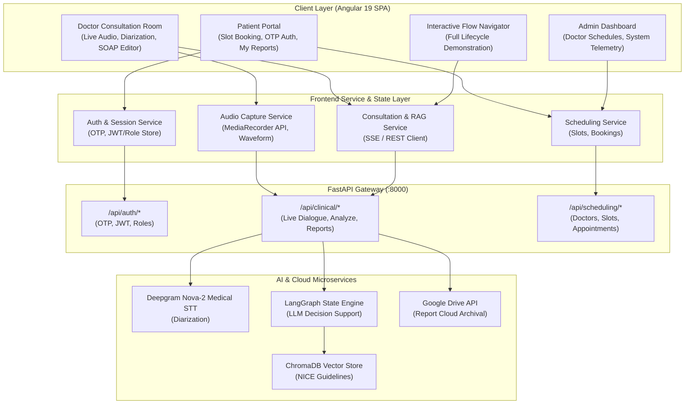
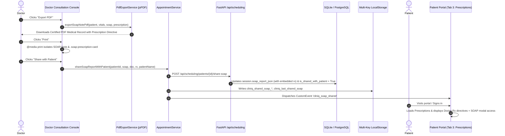
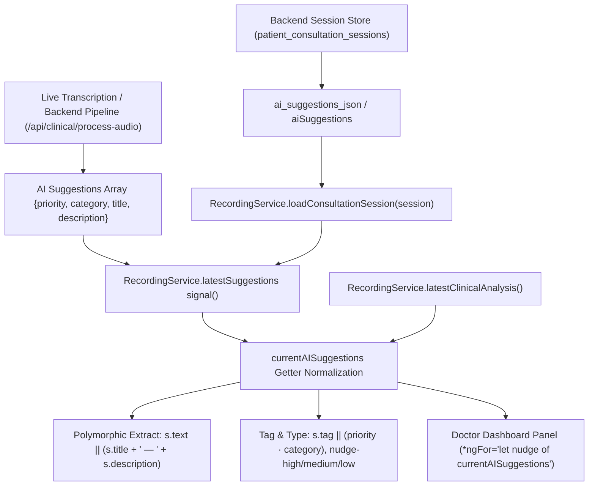
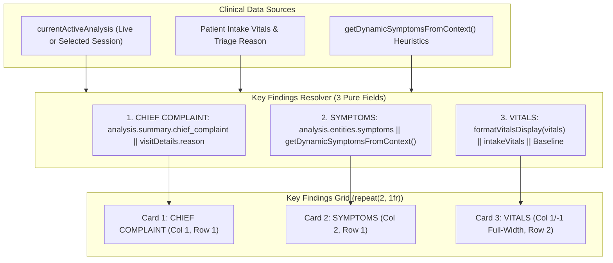
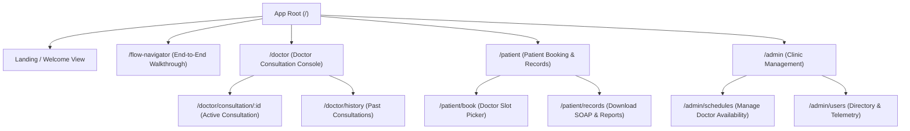

# System Architecture Document
## ClinIQ: Full-Stack & Frontend System Architecture

---

## 1. High-Level Architecture Overview

The ClinIQ system architecture follows a decoupled client-server model composed of an **Angular 19 Single Page Application (SPA)** on the frontend and an **Agentic FastAPI / LangGraph Microservice** on the backend.



---

## 2. Frontend Application Architecture (Angular 19)

### 2.1 Component & Module Hierarchy
The frontend is architected using **Angular 19 Standalone Components**, eliminating NgModule boilerplate while maximizing tree-shakability and lazy-loading efficiency.

```
frontend/src/app/
├── core/
│   ├── guards/          # RoleGuard, AuthGuard
│   ├── interceptors/    # AuthInterceptor (Bearer token injection), ErrorInterceptor
│   ├── models/          # User, Visit, Appointment, SOAP, DifferentialDiagnosis models
│   └── services/        # ApiService, AuthService, AudioService, NotificationService
├── features/
│   ├── doctor/          # Doctor consultation console, real-time audio, SOAP note generator
│   ├── patient/         # Patient appointment booking, OTP login, health records view
│   ├── admin/           # Clinic administration, doctor schedule management, system health
│   └── flow-navigator/  # Interactive end-to-end multi-step demonstration workflow
└── shared/
    ├── components/      # AudioVisualizer, DiagnosisBadge, SoapCard, ModalDialog, LoadingSpinner
    ├── directives/      # AutoFocusDirective, ClickOutsideDirective
    └── pipes/           # FormatDurationPipe, SafeHtmlPipe, RoleTitlePipe
```

### 2.2 Client-Side State & Reactivity
* **Signals & RxJS:** Angular Signals (`signal()`, `computed()`, `effect()`) are leveraged for high-frequency UI updates (e.g. recording timers, audio amplitude waveforms, and real-time transcription streaming) to ensure smooth 60 FPS rendering without zone-overhead.
* **Reactive Forms:** Form validation for appointment booking and custom patient registration with asynchronous validators for OTP checks.
* **Component Communication:** Unidirectional data flow with smart container components orchestrating dumb/presentational child components.

### 2.3 Physician Wisdom Prescription & Modal Architecture
* **SOAP Tab Prescription Placement:** Dedicated Prescription card placed inside the scrollable `.soap-preview-container` directly beneath the Plan (`P`) section and above the legal disclaimer footer.
* **Prescription Directives Model:** Implements `PrescriptionItem` typed schema (`medication`, `strength`, `route`, `frequency`, `duration`, `quantity`, `refills`, `instructions`, `prescribedBy`, `prescribedDate`).
* **Interactive Modal Workflow:** Clicking the card or "Review & edit" opens `.rx-edit-modal-card` dialog for clinicians to adjust dosages, routes, and instructions based on medical judgment.
* **Downstream Data Synchronization:** Changes update the active consultation state, inject into ReportLab/jsPDF export engines, and synchronize across browser tabs / patient portal via `appointmentService.shareSoapReportWithPatient`.

### 2.2 Doctor-to-Patient Sharing, Print, and PDF Export Pipeline



### 2.4 Dynamic 5-Tab CDS State Flow & Resilient Client Synthesis
* **Unified Analysis Signal:** `RecordingService.latestClinicalAnalysis` stores the complete clinical intelligence payload.
* **Dirty State Management:** `isSoapManuallyEdited: boolean` decouples user text edits from automated dialogue updates. When recording new audio or switching sessions, `isSoapManuallyEdited` is reset to false, allowing `effectiveSoapReport` to dynamically mirror the latest synthesized note.
* **Dynamic Fallback Generators:** When backend analysis is processing or returns default models, client synthesizers (`getDynamicDifferentialForCurrentPatient`, `getDynamicMedicinesForCurrentPatient`, `getDynamicRedFlagsForCurrentPatient`, `getDynamicFollowUpQuestionsForCurrentPatient`, `getDynamicConfidenceMetrics`, `getDynamicSoapReport`) extract keywords and dialogue context to render clinically sound data for any condition cluster (Diabetes, Hypertension, Tension Headache, Respiratory).
* **Multi-Turn Verbal Inquiries:** Verbal inquiries captured live through the ambient channel mark questions answered in `answeredQuestionIds`, dynamically elevating the 5 domain scores and overall confidence gauge.

### 2.5 AI Suggestions Normalization & Historical Session Lifecycle



* **Candidate Fallback Hierarchy:** Normalizer checks `latestSuggestions()`, falls back to `aiSuggestionsList`, and finally searches nested `clinicalAnalysis.ai_suggestions` / `clinicalAnalysis.aiSuggestions`.
* **Polymorphic Ingestion:** Transparently ingests raw LLM outputs (`{priority, category, title, description}`) as well as pre-serialized historical session items (`{id, type, tag, text}`) without data loss.

### 2.4 Clinical Vitals Normalization & Key Findings Architecture
 


* **Exclusion of Peripheral Metadata:** Extraneous administrative metadata (patient demographics, scheduled time, protocol status, session status) are completely decoupled from Key Findings, preserving dedicated focus on clinical triage indicators.
* **Braces Prevention:** Explicitly eliminates raw `{}` by verifying `Object.keys().length > 0` and sanitizing stringified JSON.
* **Triage Inheritance:** If no vitals are spoken during dialogue, intake triage vitals (`${intakeVitals} (Intake)`) are presented seamlessly.

### 2.6 Doctor Queue State Hydration, Cache Layer & Consultation Session Continuity
* **Dual-Tier State Hydration:** To prevent dashboard flicker or blank panels when signing in or reloading, `AppointmentService` initializes its `patients` signal directly from `localStorage.getItem('cliniq_patients_cache')` inside its constructor.
* **Consultation View Continuity:** Active consultation state (`viewMode = 'consultation'` and `visitDetails`) is persisted to `sessionStorage` (`cliniq_doctor_view_mode`, `cliniq_doctor_active_visit`). On page refresh (`F5`), `DoctorDashboardComponent.ngOnInit()` detects the stored session and immediately restores the active consultation view.
* **Resilient Queue Fallback:** `getDoctorQueue(doctorName, doctorId)` first filters by exact doctor ID and normalized name. If no appointments are returned, it automatically queries unassigned triage patients (`arrivalStatus == 'ARRIVED'`) and department-matching patients (e.g. Cardiology), ensuring the clinician dashboard is never blank.

---

## 3. Real-Time Audio Capture & Streaming Pipeline


1. **Permission & Context Initialization:** The `AudioService` requests microphone access via `getUserMedia({ audio: { echoCancellation: true, noiseSuppression: true, sampleRate: 16000 } })`.
2. **Real-Time Visualization:** Audio data is routed through a Web Audio `AnalyserNode` to compute instantaneous frequency and time-domain data, rendered onto an HTML5 `<canvas>` element for live visual feedback.
3. **Chunked Streaming / Upload:** Audio is recorded in `audio/webm;codecs=opus` or `audio/wav` slices, packaged into multi-part form data, and transmitted to the backend for diarization and entity extraction.

---

## 4. Multi-Role Route Architecture & Navigation



---

## 5. Security & Authentication Architecture

* **Stateless Authentication:** Authentication utilizes JSON Web Tokens (JWT) issued upon successful 6-digit OTP verification delivered via Gmail SMTP.
* **HTTP Interceptor Pipeline:**
  * `AuthInterceptor`: Automatically attaches `Authorization: Bearer <token>` to all outgoing backend API requests.
  * `ErrorInterceptor`: Catches `401 Unauthorized` or `403 Forbidden` responses, clears expired credentials, and redirects to the role login modal with user notification.
* **Route Guards (`RoleGuard`):** Evaluates user claims before activating protected routes (`DOCTOR`, `PATIENT`, `ADMIN`).

---

## 6. Infrastructure & Deployment Topology

* **Frontend Build Pipeline:** Compiled using Angular 19 application builder (`@angular-devkit/build-angular:application`) with production bundle optimizations and `environment.prod.ts` dynamic origin resolution.
* **Production Container Stack (`docker-compose.prod.yml`):**
  * `frontend`: Nginx 1.25 Alpine serving static assets on port 80 (HTTP) and port 443 (HTTPS with TLSv1.2/1.3 and self-signed SSL certificate), reverse-proxying `/api/`, `/analyze-conversation`, `/visit/`, `/reports/`, and `/health` to the backend.
  * `backend`: Python 3.11 Slim container running FastAPI/Uvicorn with 2 worker processes and persistent volumes.
  * `postgres`: PostgreSQL 16 Alpine container with isolated healthchecks and data persistence (`cliniIQ` database).
  * `redis`: Redis 7 Alpine in-memory store for RAG token caching.
* **W3C Media Devices & Secure Context Architecture:**
  * Browsers (Chrome, Edge, Safari) mandate Secure Contexts (`window.isSecureContext === true`) for `navigator.mediaDevices.getUserMedia` (Doctor Mic) and `navigator.mediaDevices.getDisplayMedia` (Teams/Meet/WhatsApp tab audio).
  * Native TLS on port 443 satisfies Secure Context requirements (`https://172.16.17.181/`), allowing seamless hardware access.
  * Unencrypted HTTP ingress (`http://172.16.17.181/`) is supported via Chrome flags (`chrome://flags/#unsafely-treat-insecure-origin-as-secure`) or direct audio file upload (`FILE_UPLOAD` channel).
* **Target Server Environment (`ubtsrv01`):**
  * **Host:** Ubuntu 24.04.5 LTS (Kernel 6.8.0-147-generic) at `172.16.17.181`.
  * **Resources:** 41 GB RAM, Docker 29.1.3, Docker Compose v2.40.3.
  * **Security & Ingress:** Cloudflare Zero Trust organization `cbtlab` (`cbtlab.cloudflareaccess.com`). Dual HTTP (80) & HTTPS (443) ingress.
  * **Status:** 100% operational. Accessible at `http://172.16.17.181/` and `https://172.16.17.181/`.

---

## 7. Relational Persistence Architecture & External Client Ingress

* **Database Port Publishing (`5432:5432`):**
  * `cliniq-postgres-prod` exposes container port 5432 to host `172.16.17.181`.
  * Allows direct inspection and management from external database clients (such as pgAdmin 4 or DBeaver) operating over Cloudflare Zero Trust / LAN.
  * Dual-database cluster supports both the production database `cliniIQ` and the historical/mirror database `cliniq_db`.
* **Client-Side Guaranteed SOAP Persistence (`DoctorDashboardComponent`):**
  * When a physician finishes a consultation, `closeAndCompleteConsultation()` in `doctor-dashboard.component.ts` invokes `saveFinalSOAPToDatabase()` prior to finalizing the session.
  * This guarantees that even if the clinician closes the consultation modal without explicitly clicking "Share", the active SOAP note is dispatched to the backend and committed into the relational `soap_feedback` table.

