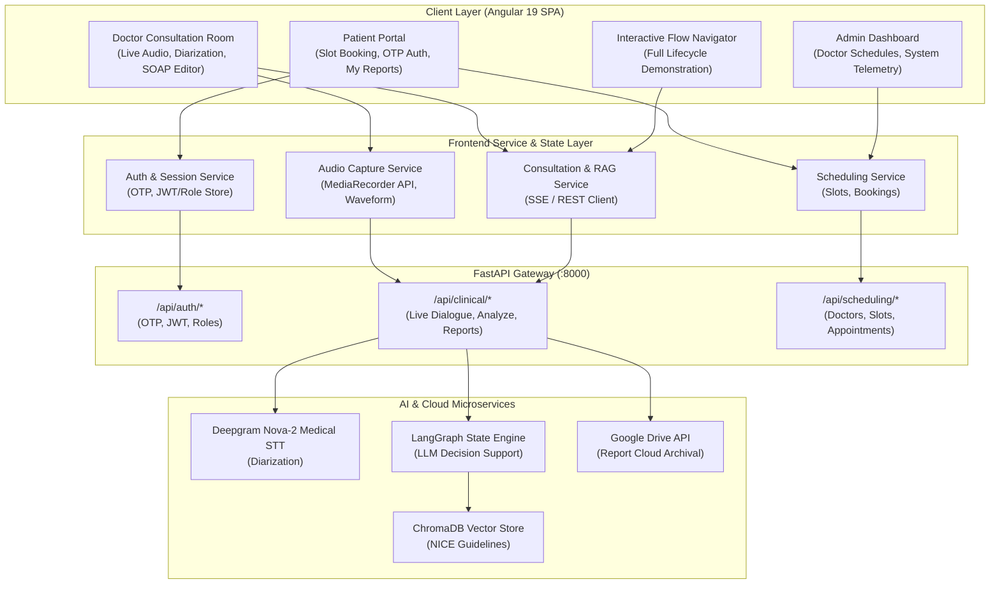
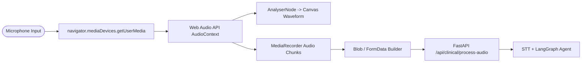
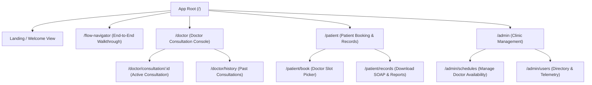

# System Architecture Document
## ClinIQ: Full-Stack & Frontend System Architecture

---

## 1. High-Level Architecture Overview

The ClinIQ system architecture follows a decoupled client-server model composed of an **Angular 19 Single Page Application (SPA)** on the frontend and an **Agentic FastAPI / LangGraph Microservice** on the backend.



---

## 2. Frontend Application Architecture (Angular 19)

### 2.1 Component & Module Hierarchy
The frontend is architected using **Angular 19 Standalone Components**, eliminating NgModule boilerplate while maximizing tree-shakability and lazy-loading efficiency.

```
frontend/src/app/
├── core/
│   ├── guards/          # RoleGuard, AuthGuard
│   ├── interceptors/    # AuthInterceptor (Bearer token injection), ErrorInterceptor
│   ├── models/          # User, Visit, Appointment, SOAP, DifferentialDiagnosis models
│   └── services/        # ApiService, AuthService, AudioService, NotificationService
├── features/
│   ├── doctor/          # Doctor consultation console, real-time audio, SOAP note generator
│   ├── patient/         # Patient appointment booking, OTP login, health records view
│   ├── admin/           # Clinic administration, doctor schedule management, system health
│   └── flow-navigator/  # Interactive end-to-end multi-step demonstration workflow
└── shared/
    ├── components/      # AudioVisualizer, DiagnosisBadge, SoapCard, ModalDialog, LoadingSpinner
    ├── directives/      # AutoFocusDirective, ClickOutsideDirective
    └── pipes/           # FormatDurationPipe, SafeHtmlPipe, RoleTitlePipe
```

### 2.2 Client-Side State & Reactivity
* **Signals & RxJS:** Angular Signals (`signal()`, `computed()`, `effect()`) are leveraged for high-frequency UI updates (e.g. recording timers, audio amplitude waveforms, and real-time transcription streaming) to ensure smooth 60 FPS rendering without zone-overhead.
* **Reactive Forms:** Form validation for appointment booking and custom patient registration with asynchronous validators for OTP checks.
* **Component Communication:** Unidirectional data flow with smart container components orchestrating dumb/presentational child components.

---

## 3. Real-Time Audio Capture & Streaming Pipeline



1. **Permission & Context Initialization:** The `AudioService` requests microphone access via `getUserMedia({ audio: { echoCancellation: true, noiseSuppression: true, sampleRate: 16000 } })`.
2. **Real-Time Visualization:** Audio data is routed through a Web Audio `AnalyserNode` to compute instantaneous frequency and time-domain data, rendered onto an HTML5 `<canvas>` element for live visual feedback.
3. **Chunked Streaming / Upload:** Audio is recorded in `audio/webm;codecs=opus` or `audio/wav` slices, packaged into multi-part form data, and transmitted to the backend for diarization and entity extraction.

---

## 4. Multi-Role Route Architecture & Navigation



---

## 5. Security & Authentication Architecture

* **Stateless Authentication:** Authentication utilizes JSON Web Tokens (JWT) issued upon successful 6-digit OTP verification delivered via Gmail SMTP.
* **HTTP Interceptor Pipeline:**
  * `AuthInterceptor`: Automatically attaches `Authorization: Bearer <token>` to all outgoing backend API requests.
  * `ErrorInterceptor`: Catches `401 Unauthorized` or `403 Forbidden` responses, clears expired credentials, and redirects to the role login modal with user notification.
* **Route Guards (`RoleGuard`):** Evaluates user claims before activating protected routes (`DOCTOR`, `PATIENT`, `ADMIN`).

---

## 6. Infrastructure & Deployment Topology

* **Frontend Build Pipeline:** Compiled using Angular CLI with esbuild / Vite bundler.
* **Static Asset Hosting:** Can be served via Nginx, AWS CloudFront + S3, or Vercel/Netlify with standard SPA fallback routing (`try_files $uri $uri/ /index.html`).
* **Environment Configuration:**
  * `environment.ts`: Development configuration pointing to `http://127.0.0.1:8000`.
  * `environment.prod.ts`: Production configuration pointing to secured HTTPS gateway.
