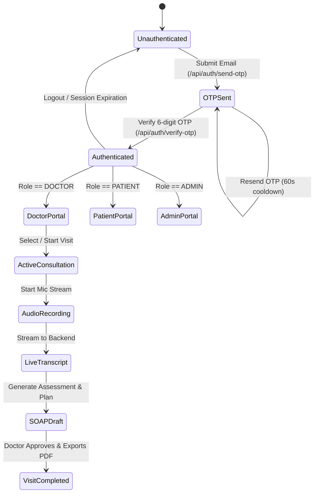

# Clinical & Technical Knowledge Base
## ClinIQ: Frontend & System Knowledge Base

---

## 1. Clinical Domain Knowledge

### 1.1 The SOAP Note Standard
The SOAP structure is the universally recognized clinical documentation standard used across ambulatory, inpatient, and outpatient healthcare systems:

| Section | Definition | ClinIQ Automated Extraction Focus |
| :--- | :--- | :--- |
| **S — Subjective** | The patient's narrative, reported symptoms, feelings, and personal history in their own words. | Chief complaint, History of Present Illness (HPI), onset, aggravating/relieving factors, duration, past medical history, family history, and review of systems. |
| **O — Objective** | Quantifiable and observable clinical findings discovered by the healthcare provider. | Vital signs (BP, HR, RR, Temp, SpO2), physical examination findings (e.g. chest auscultation, abdominal palpation), and lab/imaging results. |
| **A — Assessment** | The clinician's diagnostic synthesis and differential diagnosis ranking based on S and O. | Primary diagnosis, secondary differential diagnoses, ICD-10 codings, and clinical rationale. |
| **P — Plan** | The therapeutic, diagnostic, educational, and follow-up interventions to be executed. | Prescriptions (dosage, route, frequency), diagnostic workups (blood tests, X-rays, ECG), patient education, and next visit timeline. |

### 1.2 Differential Diagnosis (DDx) & Clinical Red Flags
* **Differential Diagnosis:** A systematic diagnostic method used to identify the presence of an entity where multiple alternatives are possible. ClinIQ calculates a confidence score for each differential candidate based on symptom overlap with clinical guidelines.
* **Red Flag Symptoms:** High-urgency clinical indicators that mandate immediate escalation (e.g., crushing retrosternal chest pain radiating to the left arm, acute focal neurological deficits, sudden severe 'thunderclap' headache).

### 1.3 Clinical Prescription Directives & Physician Autonomy
* **Prescription Structure:** Comprehensive clinical prescriptions require 8 key parameters: active compound (`medication`), potency/unit (`strength`), administration pathway (`route`), interval (`frequency`), course horizon (`duration`), unit dispense (`quantity`), renewal quota (`refills`), and patient-facing administration guidance (`instructions`).
* **Essential Hypertension Guideline Regimen:** In patients with Stage 1 Essential Hypertension (such as Marcus Delgado, 42M, BP 138/88 mmHg) who present with recurrent tension-type headaches, first-line therapy typically utilizes an ACE-inhibitor (e.g., Lisinopril 10 mg OD) with scheduled renal function (eGFR/creatinine) and potassium monitoring.
* **Clinician Review Safeguards:** Review alerts remind clinicians to cross-reference drug-drug interactions, known allergies, and contraindications before finalizing directives.

---

## 2. Audio Capture & Speech-to-Text Processing

### 2.1 Web Audio API Integration
The browser captures audio via the `MediaStreamTrack` interface and processes it in the `AudioContext`:
```
Microphone Hardware 
  -> getUserMedia() (16 kHz, Mono PCM) 
  -> AudioContext AnalyserNode 
  -> Time & Frequency Domain Byte Data 
  -> Canvas Animation Frame (Audio Waveform)
```

### 2.2 Deepgram Speech Diarization Mechanics
* **Diarization (`diarize=true`):** Deepgram's Nova-2 medical speech model separates speaker turns by analyzing vocal acoustic profiles, assigning `speaker: 0` (Doctor) and `speaker: 1` (Patient).
* **Utterance Processing:** Each utterance includes `start`, `end`, `confidence`, `speaker`, and `words` arrays, allowing the frontend to highlight active spoken phrases in real time.

---

## 3. Retrieval-Augmented Generation (RAG) on NICE Guidelines

* **NICE Guidelines (National Institute for Health and Care Excellence):** Evidence-based medical recommendations and clinical decision trees covering cardiovascular, respiratory, endocrine, gastrointestinal, and mental health conditions.
* **Vector Search Strategy:**
  1. Symptoms and clinical entities extracted from the dialogue form semantic queries.
  2. Embeddings are generated using HuggingFace / OpenAI embedding models (`sentence-transformers/all-MiniLM-L6-v2`).
  3. ChromaDB performs cosine similarity search over chunked NICE guideline documents ($k=4$ nearest guideline passages).
  4. The retrieved clinical passages are injected into the LangGraph LLM prompt to ground the differential diagnoses in validated evidence.

---

## 4. Frontend State & Authentication Lifecycle



---

## 5. Third-Party Integrations & Cloud Infrastructure

* **Google Drive API:** Automatic cloud backup for generated medical PDFs using a Google Cloud Service Account with OAuth2 JWT grant and shared drive permissions.
* **Gmail SMTP Service:** Secure transactional email engine sending OTP codes, appointment booking confirmations, and patient aftercare instructions.
* **OpenRouter / OpenAI LLM APIs:** Agentic orchestration of reasoning prompts, clinical entity recognition, and medical summarization.

---

## 6. Clinical Prescription Directives & Patient Aftercare Models

* **Clinical Data Schema:**
  * `medication`: Generic and trade name (e.g. Amoxicillin, Lisinopril).
  * `strength`: Exact dosage quantity and metric (e.g. 500 mg, 10 mg).
  * `route`: Mode of administration (e.g. Oral, Sublingual, Topical, Intravenous).
  * `frequency`: Timing pattern (e.g. Three times daily, Once daily - morning, PRN).
  * `duration`: Course length (e.g. 7 days, 14 days, 30 days).
  * `quantity`: Dispensation package size (e.g. 21 capsules, 30 tablets).
  * `refills`: Allowed doctor refills (e.g. 0 refills, 3 refills).
  * `instructions`: Precise patient guidance (e.g. 'Take one capsule three times daily with a full glass of water after meals until completed.').
* **Patient Portal Integration:**
  * Automatically populates Tab 3: Prescriptions with active badges and structured directives chips (`Strength`, `Route`, `Frequency`, `Duration`, `Quantity`, `Refills`).
  * Direct one-click modal viewer for the verified clinical SOAP report and official electronic signoff.

---

## 7. Real-Time Autonomous AI Suggestions Taxonomy

* **Priority Tiers:**
  * `HIGH` (`.nudge-high`): Urgent diagnostic exclusions, acute red-flag conditions, medication contraindications, or essential timeline clarifications.
  * `MEDIUM` (`.nudge-medium`): Pertinent lifestyle inquiries, dietary screenings, baseline lab workups, or interval follow-ups.
  * `LOW` (`.nudge-low`): Preventative maintenance, administrative wellness checks, or routine health literacy checks.
* **Clinical Categories:** `CLINICAL EVALUATION`, `DIFFERENTIAL`, `MEDICATION RECONCILIATION`, `SYMPTOM DETAIL`, `LAB WORKUP`, `LIFESTYLE`, `FOLLOW-UP`.
* **Polymorphic Ingestion Contract:** The UI standardizes items into `{ id, type, tag, text, title, description, priority, category }` guaranteeing complete cross-session persistence.

---

## 8. Clinical Vitals Extraction & EHR Triage Norms

* **Standard Adult Baseline Vitals:**
  * Blood Pressure (BP): Normal `< 120/80 mmHg`, Stage 1 Hypertension `130-139 / 80-89 mmHg`.
  * Heart Rate (HR): Normal `60-100 bpm`.
  * Oxygen Saturation (SpO2): Normal `95-100%`.
  * Temperature (Temp): Normal `36.5 - 37.5 °C` (`97.7 - 99.5 °F`).
  * Blood Glucose: Fasting `< 100 mg/dL`, Random `< 140 mg/dL` (elevated when `> 200 mg/dL` presenting with polydipsia, polyuria, extreme fatigue).
* **Consultation Dialogue Parsing Rule:** Vitals not explicitly stated in verbal exchanges default to initial triage check-in metrics (`(Intake)`), ensuring clinical records maintain physical examination baselines without rendering empty structures or raw `{}` braces.

---

## 9. Condition-Adaptive CDS Synthesis & Dynamic Tab Taxonomy

### 9.1 Multi-Condition Archetype Mapping
When processing teleconsultations (MS Teams, Google Meet, WhatsApp, or In-Person), the CDS pipeline continuously classifies the consultation into clinical presentation archetypes if full LLM extraction is pending or partially unavailable:

1. **Type 2 Diabetes Mellitus / Metabolic Syndrome:**
   * *Clinical Keywords:* Sugar, glucose, thirst, polydipsia, urination, polyuria, metformin, HbA1c, fasting.
   * *Differential Diagnoses:* Type 2 Diabetes Mellitus (E11.9, 88%), Prediabetes (R73.03, 62%), Diabetic Nephropathy Screening (E11.21, 35%).
   * *Red Flags:* Suspected Diabetic Ketoacidosis (DKA) / HHS; Diabetic foot ulceration; acute visual changes.
   * *Guideline Medications:* Metformin 500 mg BD (Biguanide, ADA/NICE), Empagliflozin 10 mg OD (SGLT2 Inhibitor, ADA/EASD), Atorvastatin 20 mg OD (Statin, ADA Standards of Care).
   * *Protocol Follow-up:* Fasting blood glucose tracking, 3-month HbA1c target verification, annual retinal exam.

2. **Essential Hypertension / Cardiovascular Risk:**
   * *Clinical Keywords:* Blood pressure, hypertension, BP, dizzy, chest pressure, Lisinopril, Amlodipine, salty.
   * *Differential Diagnoses:* Essential (Primary) Hypertension (I10, 85%), White Coat Hypertension (R03.0, 48%), Secondary Hypertension / Renovascular (I15.9, 25%).
   * *Red Flags:* Hypertensive Emergency (BP > 180/120 with end-organ symptoms); retrosternal crushing pain.
   * *Guideline Medications:* Lisinopril 10 mg OD (ACE-Inhibitor, ACC/AHA), Amlodipine 5 mg OD (CCB, NICE NG136), Hydrochlorothiazide 12.5 mg OD (Thiazide diuretic).
   * *Protocol Follow-up:* Twice-daily home BP diary, serum creatinine & electrolytes at 4 weeks, DASH diet adherence.

3. **Tension-Type Headache & Primary Cephalea:**
   * *Clinical Keywords:* Headache, head pain, tight band, stress, temple, throbbing, neck stiffness.
   * *Differential Diagnoses:* Tension-Type Headache (G44.2, 82%), Migraine without Aura (G43.0, 54%), Cervicogenic Headache (M54.2, 38%).
   * *Red Flags:* Sudden thunderclap headache; systemic signs (fever, neck stiffness, meningismus); new focal neurological deficit.
   * *Guideline Medications:* Paracetamol 1000 mg PRN (Analgesic, BHS/NICE CG150), Ibuprofen 400 mg PRN (NSAID, BHS), Amitriptyline 10 mg Nocté (TCA preventative).
   * *Protocol Follow-up:* Headache trigger diary, sleep hygiene assessment, red-flag return guidance.

4. **Acute Respiratory Infection / Bronchial Presentation:**
   * *Clinical Keywords:* Cough, fever, breath, lungs, chest, phlegm, wheeze, sputum, throat.
   * *Differential Diagnoses:* Acute Bronchitis (J20.9, 78%), Upper Respiratory Tract Infection (J06.9, 64%), Community-Acquired Pneumonia (J18.9, 38%).
   * *Red Flags:* SpO2 < 92%, severe respiratory distress, hemoptysis, pleuritic chest pain.
   * *Guideline Medications:* Paracetamol 650 mg QDS PRN (Antipyretic/analgesic), Amoxicillin 500 mg TDS (Antibiotic, NICE NG138 - if bacterial pneumonia confirmed), Salbutamol Inhaler 100 mcg PRN (Bronchodilator).
   * *Protocol Follow-up:* SpO2 monitoring, hydration guidelines, 48-hour worsening return instructions.

### 9.2 Confidence Engine Dynamic Domain Formulation
Confidence is never statically frozen at 58%. It scales mathematically across five core clinical dimensions:
1. **Symptom Completeness:** Measures depth of reported chief complaints, onset, duration, and severity markers ($35\% \rightarrow 95\%$).
2. **Medical History Coverage:** Evaluates past diagnoses, chronic treatments, and allergy disclosures ($40\% \rightarrow 90\%$).
3. **Lifestyle & Social History:** Gauges sleep, physical activity, alcohol, tobacco, and stress profile extraction ($25\% \rightarrow 85\%$).
4. **DDx Alignment:** Measures diagnostic separation margin between candidate #1 and candidate #2 ($45\% \rightarrow 92\%$).
5. **Guideline Adherence:** Validates completeness of clinical inquiry coverage and safety threshold compliance ($50\% \rightarrow 96\%$).

The overall confidence index is computed as the weighted composite average:
$$\text{Score} = \text{round}\left(\sum_{i=1}^5 w_i \times \text{Domain}_i\right)$$
If the composite score is $\ge 70\%$, the alert level displays `High — Clinical Consensus`. If between $50\%$ and $69\%$, it indicates `Moderate — Review`. Below $50\%$, it warns `Low — Follow-up Required`.

---

## 10. Cloudflare Zero Trust Production Infrastructure & Routing

### 10.1 Zero Trust Private Gateway Topology
The production deployment on host `ubtsrv01` (`172.16.17.181`) is secured through Cloudflare Zero Trust team `cbtlab` (`cbtlab.cloudflareaccess.com`):
* **Local WARP Interface:** `10.64.20.180` assigned to enrolled client device.
* **Server Target:** `172.16.17.181` running Ubuntu 24.04.5 LTS (41 GB RAM, Linux Kernel 6.8).
* **Ingress Port:** Standard HTTP port 80 exposed via Docker bridge network.
* **Reverse Proxy Mapping:**
  * Web Application SPA: `http://172.16.17.181/` -> Nginx -> `/usr/share/nginx/html`
  * API Endpoints: `http://172.16.17.181/api/*` -> Nginx -> `http://backend:8000/api/*`
  * Analysis Endpoint: `http://172.16.17.181/analyze-conversation` -> Nginx -> `http://backend:8000/analyze-conversation`
  * Visit Management: `http://172.16.17.181/visit/*` -> Nginx -> `http://backend:8000/visit/*`
  * Reports & PDFs: `http://172.16.17.181/reports/*` -> Nginx -> `http://backend:8000/reports/*`
  * Health Telemetry: `http://172.16.17.181/health` -> Nginx -> `http://backend:8000/health`
  * Swagger OpenAPI: `http://172.16.17.181/docs` -> Nginx -> `http://backend:8000/docs`


