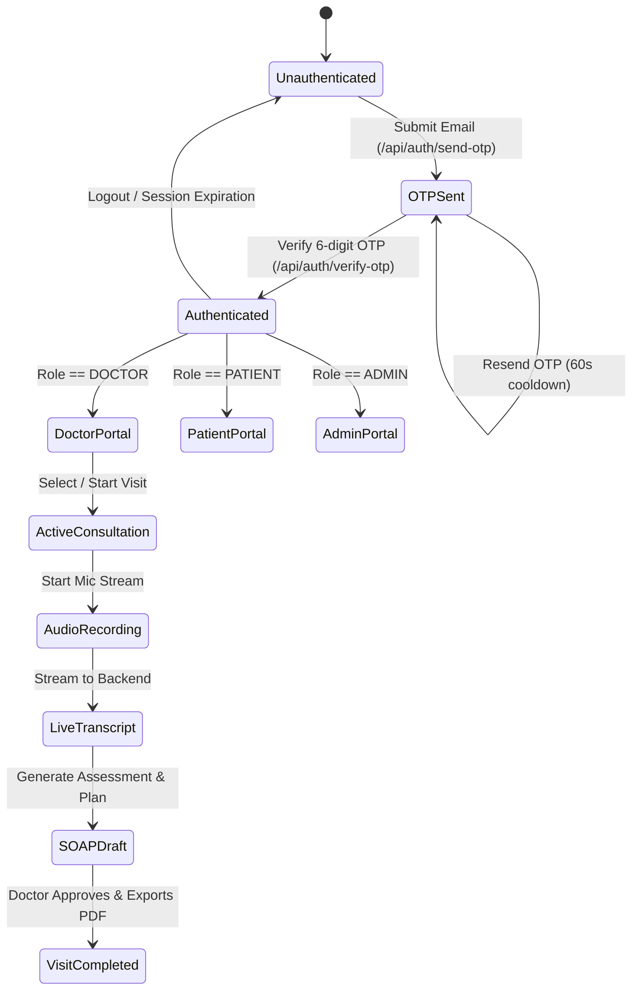

# Clinical & Technical Knowledge Base
## ClinIQ: Frontend & System Knowledge Base

---

## 1. Clinical Domain Knowledge

### 1.1 The SOAP Note Standard
The SOAP structure is the universally recognized clinical documentation standard used across ambulatory, inpatient, and outpatient healthcare systems:

| Section | Definition | ClinIQ Automated Extraction Focus |
| :--- | :--- | :--- |
| **S — Subjective** | The patient's narrative, reported symptoms, feelings, and personal history in their own words. | Chief complaint, History of Present Illness (HPI), onset, aggravating/relieving factors, duration, past medical history, family history, and review of systems. |
| **O — Objective** | Quantifiable and observable clinical findings discovered by the healthcare provider. | Vital signs (BP, HR, RR, Temp, SpO2), physical examination findings (e.g. chest auscultation, abdominal palpation), and lab/imaging results. |
| **A — Assessment** | The clinician's diagnostic synthesis and differential diagnosis ranking based on S and O. | Primary diagnosis, secondary differential diagnoses, ICD-10 codings, and clinical rationale. |
| **P — Plan** | The therapeutic, diagnostic, educational, and follow-up interventions to be executed. | Prescriptions (dosage, route, frequency), diagnostic workups (blood tests, X-rays, ECG), patient education, and next visit timeline. |

### 1.2 Differential Diagnosis (DDx) & Clinical Red Flags
* **Differential Diagnosis:** A systematic diagnostic method used to identify the presence of an entity where multiple alternatives are possible. ClinIQ calculates a confidence score for each differential candidate based on symptom overlap with clinical guidelines.
* **Red Flag Symptoms:** High-urgency clinical indicators that mandate immediate escalation (e.g., crushing retrosternal chest pain radiating to the left arm, acute focal neurological deficits, sudden severe 'thunderclap' headache).

### 1.3 Clinical Prescription Directives & Physician Autonomy
* **Prescription Structure:** Comprehensive clinical prescriptions require 8 key parameters: active compound (`medication`), potency/unit (`strength`), administration pathway (`route`), interval (`frequency`), course horizon (`duration`), unit dispense (`quantity`), renewal quota (`refills`), and patient-facing administration guidance (`instructions`).
* **Essential Hypertension Guideline Regimen:** In patients with Stage 1 Essential Hypertension (such as Marcus Delgado, 42M, BP 138/88 mmHg) who present with recurrent tension-type headaches, first-line therapy typically utilizes an ACE-inhibitor (e.g., Lisinopril 10 mg OD) with scheduled renal function (eGFR/creatinine) and potassium monitoring.
* **Clinician Review Safeguards:** Review alerts remind clinicians to cross-reference drug-drug interactions, known allergies, and contraindications before finalizing directives.

---

## 2. Audio Capture & Speech-to-Text Processing

### 2.1 Web Audio API Integration
The browser captures audio via the `MediaStreamTrack` interface and processes it in the `AudioContext`:
```
Microphone Hardware 
  -> getUserMedia() (16 kHz, Mono PCM) 
  -> AudioContext AnalyserNode 
  -> Time & Frequency Domain Byte Data 
  -> Canvas Animation Frame (Audio Waveform)
```

### 2.2 Deepgram Speech Diarization Mechanics
* **Diarization (`diarize=true`):** Deepgram's Nova-2 medical speech model separates speaker turns by analyzing vocal acoustic profiles, assigning `speaker: 0` (Doctor) and `speaker: 1` (Patient).
* **Utterance Processing:** Each utterance includes `start`, `end`, `confidence`, `speaker`, and `words` arrays, allowing the frontend to highlight active spoken phrases in real time.

---

## 3. Retrieval-Augmented Generation (RAG) on NICE Guidelines

* **NICE Guidelines (National Institute for Health and Care Excellence):** Evidence-based medical recommendations and clinical decision trees covering cardiovascular, respiratory, endocrine, gastrointestinal, and mental health conditions.
* **Vector Search Strategy:**
  1. Symptoms and clinical entities extracted from the dialogue form semantic queries.
  2. Embeddings are generated using HuggingFace / OpenAI embedding models (`sentence-transformers/all-MiniLM-L6-v2`).
  3. ChromaDB performs cosine similarity search over chunked NICE guideline documents ($k=4$ nearest guideline passages).
  4. The retrieved clinical passages are injected into the LangGraph LLM prompt to ground the differential diagnoses in validated evidence.

---

## 4. Frontend State & Authentication Lifecycle



---

## 5. Third-Party Integrations & Cloud Infrastructure

* **Google Drive API:** Automatic cloud backup for generated medical PDFs using a Google Cloud Service Account with OAuth2 JWT grant and shared drive permissions.
* **Gmail SMTP Service:** Secure transactional email engine sending OTP codes, appointment booking confirmations, and patient aftercare instructions.
* **OpenRouter / OpenAI LLM APIs:** Agentic orchestration of reasoning prompts, clinical entity recognition, and medical summarization.

---

## 6. Clinical Prescription Directives & Patient Aftercare Models

* **Clinical Data Schema:**
  * `medication`: Generic and trade name (e.g. Amoxicillin, Lisinopril).
  * `strength`: Exact dosage quantity and metric (e.g. 500 mg, 10 mg).
  * `route`: Mode of administration (e.g. Oral, Sublingual, Topical, Intravenous).
  * `frequency`: Timing pattern (e.g. Three times daily, Once daily - morning, PRN).
  * `duration`: Course length (e.g. 7 days, 14 days, 30 days).
  * `quantity`: Dispensation package size (e.g. 21 capsules, 30 tablets).
  * `refills`: Allowed doctor refills (e.g. 0 refills, 3 refills).
  * `instructions`: Precise patient guidance (e.g. 'Take one capsule three times daily with a full glass of water after meals until completed.').
* **Patient Portal Integration:**
  * Automatically populates Tab 3: Prescriptions with active badges and structured directives chips (`Strength`, `Route`, `Frequency`, `Duration`, `Quantity`, `Refills`).
  * Direct one-click modal viewer for the verified clinical SOAP report and official electronic signoff.

