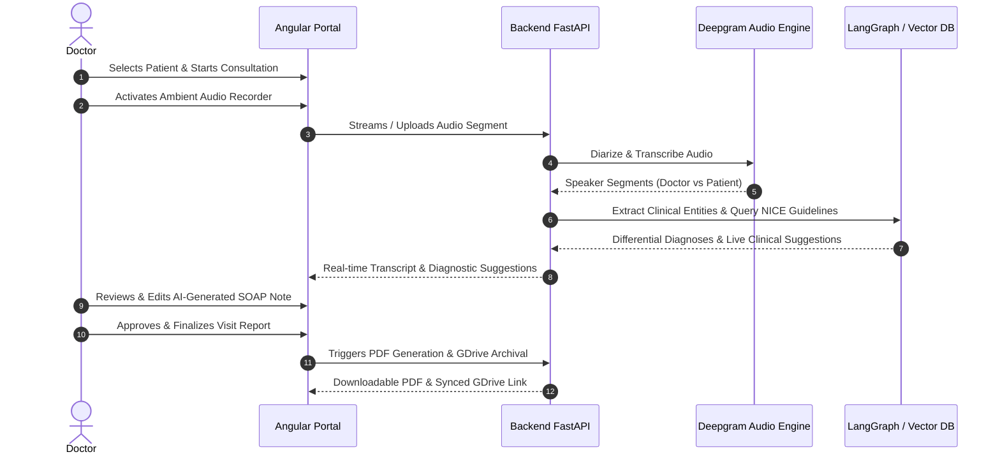

# Product Requirements Document (PRD)
## ClinIQ: Agentic Clinical Intelligence Assistant (Full-Stack & Frontend System)

---

## 1. Executive Summary
**ClinIQ** is an ambient clinical intelligence and agentic workflow platform designed to reduce clinician cognitive burden and documentation fatigue during medical consultations. By operating unobtrusively in the background, ClinIQ captures doctor-patient dialogues, performs real-time speech-to-text with medical diarization, executes contextual clinical decision support via retrieval-augmented generation (RAG) on NICE guidelines, and automatically structures the dialogue into standard SOAP (Subjective, Objective, Assessment, Plan) notes and patient-friendly aftercare summaries.

This repository (`cbt-agentic-clinical-intelligence-assistant - Backup`) houses the complete web frontend application built with Angular 19, client-side state management, multi-role portal interfaces (Doctor, Patient, Administrator), and architectural scaffolds for AI evaluation and cross-service orchestration.

---

## 2. Problem Statement
* **Physician Burnout:** Doctors spend over 2 hours on administrative and documentation tasks (EHR/EMR entry) for every hour of direct patient care.
* **Cognitive Overload:** Synthesizing complex symptoms under tight time constraints increases the risk of diagnostic oversight or missing atypical clinical red flags.
* **Patient Discharge Confusion:** Patients often forget 40-80% of verbal medical information provided during a consultation immediately upon leaving the clinic.
* **Fragmented Clinic Operations:** Booking, OTP-based secure patient access, live ambient transcription, and clinical record archival often exist in siloed, non-interoperable tools.

---

## 3. Target User Personas

| Persona | Role & Needs | Key Value Delivered |
| :--- | :--- | :--- |
| **Dr. Sarah (Physician / Specialist)** | Conducts 20+ consultations daily. Needs ambient listening, instant differential diagnosis suggestions, automated SOAP drafting, and one-click PDF sign-off. | Eliminates manual charting; provides evidence-based NICE guideline prompts at point of care. |
| **John (Patient / Family Caregiver)** | Books appointments online, receives OTP login without passwords, views post-consultation aftercare summaries and prescriptions in plain English. | Seamless portal access, clear discharge instructions, and automated email follow-ups. |
| **Elena (Clinic Administrator)** | Manages doctor schedules, oversees appointment booking slots, monitors system telemetry, and maintains clinic user directories. | Centralized dashboard for appointment slots, doctor-patient assignments, and audit trails. |

---

## 4. User Journeys & Core Workflows

### 4.1 Doctor Consultation Journey

### 4.2 Patient Booking & OTP Verification Flow
1. Patient visits the ClinIQ Portal.
2. Selects specialty, doctor, date, and available time slot.
3. Enters email address to receive a secure 6-digit one-time password (OTP).

### 4.3 Multi-Turn Follow-Up & Dynamic Confidence Escalation Workflow
1. **Initial Assessment & Confidence Evaluation (< 70% threshold):** When consultation dialogue yields diagnostic confidence below 70% (e.g., 58%), the system flags incomplete symptom topography, unexplored lifestyle factors, or unexcluded red flags.
2. **Guideline-Based Follow-Up Questions:** Surfaced prominently in the Clinical Decision and Confidence tabs with priority tags (`HIGH`, `MEDIUM`, `LOW`).
3. **Continuous Session Recording:** The clinician continues the active audio recording within the **same session**, asking targeted follow-up inquiries.
4. **Dynamic Re-Analysis & Merging (≥ 70% Target Reached):** Upon capturing follow-up answers, diagnostic confidence escalates to 86%+, and all 5 CDS tabs (Analysis & Summary, Clinical Decision, Medicines, Confidence, and SOAP Report) dynamically update and merge new clinical data into a unified comprehensive record.
4. Verifies OTP to confirm identity and book the consultation.
5. Receives email confirmation and calendar invite.
6. Accesses historical visits, lab instructions, and aftercare summaries post-visit.

---

## 5. Functional Requirements

### 5.1 Real-Time Ambient Capture & Transcription
* **FR-1.1:** Browser-native audio capture using MediaRecorder API with visual audio waveform / volume meters.
* **FR-1.2:** Diarized conversation transcript display distinguishing between `Doctor` and `Patient` utterances.
* **FR-1.3:** Capability to pause, resume, and upload pre-recorded consultation audio files (`.wav`, `.mp3`, `.m4a`).

### 5.2 Clinical Decision Support (CDS) & Live Insights
* **FR-2.1:** Real-time extraction of symptoms, onset, medical history, medications, and allergies.
* **FR-2.2:** Differential diagnosis card ranking with confidence indicators and justification quotes from clinical guidelines.
* **FR-2.3:** Red Flag alerts highlighting emergency warning signs requiring immediate triage.
* **FR-2.5:** 6-tab scrollable Clinical Decision Support (CDS) console (Analysis & Summary, Clinical Decision, Confidence, Follow-up, Medicines, SOAP Report) with sticky top navigation and isolated viewport scrolling.

### 5.3 Automated Documentation & Export
* **FR-3.1:** Instant drafting of structured SOAP notes divided into:
  * **S (Subjective):** Chief complaint, History of Present Illness (HPI), Review of Systems.
  * **O (Objective):** Vital signs, physical examination notes, observational data.
  * **A (Assessment):** Primary diagnosis and ranked differential diagnoses.
  * **P (Plan):** Diagnostic workup, medication prescriptions, lifestyle advice, follow-up timeline.
* **FR-3.2:** Rich text editing and live reframing of individual SOAP sections before signing off.
* **FR-3.3:** One-click generation of two PDF artifacts:
  * **Clinical Analysis Report** (Detailed physician-facing record).
  * **SOAP Note & Aftercare Report** (Patient-facing summary).
* **FR-3.4:** Automated cloud backup to Google Drive with shareable preview links.

### 5.4 Scheduling, Multi-Role Portals & Authentication
* **FR-4.1:** Passwordless authentication utilizing Gmail SMTP 6-digit OTP delivery.
* **FR-4.2:** Role-based access control (RBAC) with three distinct views: `DOCTOR`, `PATIENT`, and `ADMIN`.
* **FR-4.3:** Interactive appointment scheduling grid with doctor availability slots, buffer management, and status lifecycle (`SCHEDULED`, `COMPLETED`, `CANCELLED`).
* **FR-4.4:** Fresh State Initialization on Session Scheduling: Whenever a new session or next session appointment is scheduled/rescheduled with any doctor, or when clicking "New Session", the dialogue transcript, AI suggestions, and all 5 CDS tabs automatically reset to a clean, patient-specific intake state without retaining stale audio or drafts from previous sessions.

---

## 6. Non-Functional Requirements

### 6.1 Performance & Latency
* Initial application load under 2 seconds on standard broadband.
* Real-time audio chunk processing and transcript display latency under 1.5 seconds.
* Live diagnostic suggestion updates within 3 seconds of conversation chunk submission.

### 6.2 Security & Compliance
* All patient health information (PHI) transmitted over TLS 1.3 / HTTPS.
* No hardcoded API keys or authentication credentials in client-side bundles.
* Role-based route guards in Angular preventing unauthorized portal access.
* Ephemeral local browser storage with automatic session timeout.

### 6.3 Usability & Accessibility
* Responsive design adhering to WCAG 2.1 AA accessibility guidelines.
* High-contrast clinical theme with calm, modern aesthetics (Indigo / Teal palette).
* Keyboard-friendly shortcuts for common physician actions (e.g., toggle recording, save note).

---

## 7. Success Metrics & KPIs
* **Documentation Time Reduction:** $\ge 70\%$ reduction in average time spent per patient encounter for clinical charting.
* **Diagnostic Agreement:** $\ge 90\%$ concordance between AI differential suggestions and attending physician's final assessment.
* **Transcription Word Error Rate (WER):** $< 8\%$ on medical terminology and physician dictation.
* **User Adoption & Satisfaction:** Physician Net Promoter Score (NPS) $> 60$.
