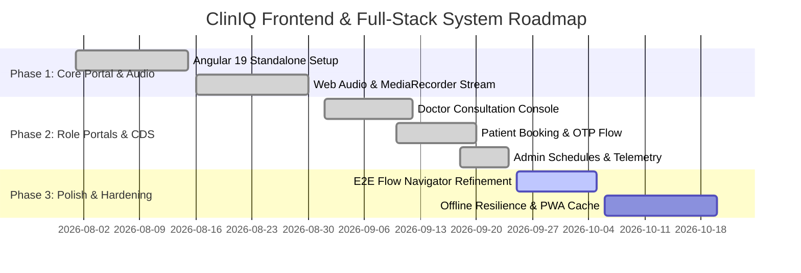

# Project Tasks & Development Roadmap
## ClinIQ: Frontend & Full-Stack System Tasks

---

## 1. Project Milestones

---

## 2. Detailed Task Breakdown

### 2.1 Completed Tasks (Done)
- [x] **TSK-FE-01:** Scaffold Angular 19 application with SCSS design token architecture (`styles.scss`).
- [x] **TSK-FE-02:** Implement browser-based audio recorder service with HTML5 canvas waveform visualization.
- [x] **TSK-FE-03:** Build Doctor Consultation workspace with 3-column split (Audio Stream, AI Decision Support, SOAP Note Editor).
- [x] **TSK-FE-04:** Implement Patient Portal with interactive doctor slot booking, multi-step stepper, and OTP modal.
- [x] **TSK-FE-05:** Build Admin Dashboard with doctor availability grid and clinic management controls.
- [x] **TSK-FE-06:** Implement `AuthService` and `AuthInterceptor` supporting Bearer token injection and role-based guards (`RoleGuard`).
- [x] **TSK-FE-07:** Implement Interactive Flow Navigator for demonstrating full patient-to-doctor lifecycle.
- [x] **TSK-FE-08:** Set role-specific demo email addresses as clean input placeholders across Doctor, Administrator, and Patient sign-in screens.

### 2.2 Active Sprint Tasks (In Progress)
- [ ] **TSK-FE-08:** Refine real-time differential diagnosis card animations and interactive citation tooltips linking to NICE guidelines.
- [ ] **TSK-FE-09:** Add client-side PDF preview modal before triggering direct download or Google Drive sync.
- [ ] **TSK-FE-10:** Optimize audio buffer streaming chunks for low-bandwidth clinic connections.

### 2.3 Future Roadmap (Backlog)
- [ ] **TSK-FE-11:** Progressive Web App (PWA) configuration with service worker caching for offline consultation viewing.
- [ ] **TSK-FE-12:** WebRTC peer-to-peer video integration for built-in telehealth consultations.
- [ ] **TSK-FE-13:** Multi-language UI localization (i18n) supporting Spanish, French, and Hindi.
- [ ] **TSK-FE-14:** Voice-activated physician command macros (e.g. "ClinIQ, prescribe Amoxicillin 500mg TDS for 5 days").

---

## 3. Bug Tracking & Quality Backlog

| Issue ID | Description | Severity | Target Resolution |
| :--- | :--- | :--- | :--- |
| **BUG-FE-01** | Fix audio recorder waveform freeze when switching browser tabs during long recording sessions. | Medium | Sprint 4 |
| **BUG-FE-02** | Ensure OTP countdown timer preserves state if user temporarily navigates away from modal. | Low | Sprint 4 |
