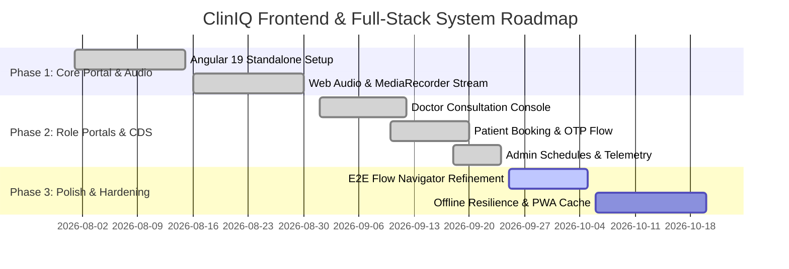

# Project Tasks & Development Roadmap
## ClinIQ: Frontend & Full-Stack System Tasks

---

## 1. Project Milestones

---

## 2. Detailed Task Breakdown

### 2.1 Completed Tasks (Done)
- [x] **TSK-FE-01:** Scaffold Angular 19 application with SCSS design token architecture (`styles.scss`).
- [x] **TSK-FE-02:** Implement browser-based audio recorder service with HTML5 canvas waveform visualization.
- [x] **TSK-FE-03:** Build Doctor Consultation workspace with 3-column split (Audio Stream, AI Decision Support, SOAP Note Editor).
- [x] **TSK-FE-04:** Implement Patient Portal with interactive doctor slot booking, multi-step stepper, and OTP modal.
- [x] **TSK-FE-05:** Build Admin Dashboard with doctor availability grid and clinic management controls.
- [x] **TSK-FE-06:** Implement `AuthService` and `AuthInterceptor` supporting Bearer token injection and role-based guards (`RoleGuard`).
- [x] **TSK-FE-07:** Implement Interactive Flow Navigator for demonstrating full patient-to-doctor lifecycle.
- [x] **TSK-FE-10:** Dynamic Follow-Up Questions Extraction & Extensible Architecture: bound dashboard follow-up cards directly to live backend analysis outputs with condition-adaptive fallbacks and extensible interfaces for upcoming graph-based follow-up processes.
- [x] **TSK-FE-11:** Live Doctor Verbal In-Session Audio Probing & Dedicated "Automate" Mode: implemented continuous microphone recording workflow for verbal doctor inquiries along with a dedicated "Automate" button on the follow-up questions card that auto-simulates multi-turn dialogue, updates all 5 CDS tabs, and elevates confidence to ≥70%.
- [x] **TSK-FE-12:** Multi-Appointment Sequential Session Lifecycle: ensured that a consultation only completes as Session 1 upon clicking "Close Consultation"; re-opening the patient for subsequent appointments automatically initializes Session 2 (and Session N+1) while preserving all historical completed session records in the history tabs.
- [x] **TSK-FE-13:** Premium Clinical Protocol Inquiry Card Redesign: redesigned the Guideline Follow-Up Questions section with clinical grade card tiles, straight vertical priority color strips (High/Moderate/Routine), smooth hover lifts, live audio wave animation boxes, addressed finding snippet cards, and a dynamic progress bar tracker.
- [x] **TSK-FE-14:** CDS Tab Screens Scrollable Viewport & Sticky Navigation: Configured responsive flex-column container layout with pinned/sticky top navigation and 5-tab bar (`.intel-tabs-nav`), paired with scrollable `.intel-tab-content-area` and individual `.tab-pane` viewports with custom scrollbars across all CDS tabs (Analysis, Clinical Decision, Medicines, Confidence, SOAP Note).
- [x] **TSK-FE-15:** Scheduled Next Session & New Session Fresh State Initialization: Ensured that whenever a next session or new session appointment is scheduled/rescheduled for a patient with any doctor, or when starting a "New Session", the dialogue Transcript, AI suggestions, and all 5 CDS tabs (Analysis & Summary, Clinical Decision, Medicines, Confidence, SOAP Report) start with a 100% clean, patient-specific slate without leaking previous consultation drafts.
- [x] **TSK-FE-16:** Transcript Speaker Disambiguation & Initials Resolution: Fixed consultation transcript rendering so Doctor turns cleanly align on the doctor side (left) with Doctor initials (`AK`), and Patient turns cleanly align on the patient side (right) with Patient initials (`T`), eliminating speaker tag collapse.
- [x] **TSK-FE-17:** Follow-Up Dialogue Automation Decommissioning & Real Transcript Preservation: Removed automated protocol simulation buttons ("Automate Protocol") and eliminated synthetic dialogue injection into the session transcript, ensuring all conversation transcripts strictly reflect authentic doctor-patient verbal consultations and ambient recordings.
- [x] **TSK-FE-18:** 6-Tab CDS Architecture & Dedicated Follow-Up Tab Arrangement: Re-ordered the consultation intelligence tabs into the exact sequence: 1. Analysis & Summary, 2. Clinical Decision, 3. Confidence, 4. Follow-up, 5. Medicines, 6. SOAP Report; and extracted the full Targeted Clinical Protocol Inquiries card system into its dedicated Follow-up tab.
- [x] **TSK-FE-19:** High-Contrast Professional Notification Banner & Emoji Decommissioning: Redesigned the top consultation notice banner with high-contrast clinical typography, solid border accents, live pulsing recording indicator, and clean SVG iconography, eliminating all emojis for optimal clinical scannability.
- [x] **TSK-FE-20:** Physician Wisdom Prescription Directives & Interactive Modal: Implemented interactive Prescription card placed at the bottom of the SOAP Report tab (below Plan), coupled with a full-fidelity "Edit prescription" modal dialog supporting physician-directed medication, strength, route, frequency, duration, quantity, refills, instructions, and review warnings. Integrated prescription data into PDF exports, patient portal sync, and patient-specific default mapping.
- [x] **TSK-FE-21:** Doctor Consultation Export (Download PDF), Dedicated Print, & Patient Portal Prescription & SOAP Note Sharing Synchronization: Implemented one-click certified PDF export incorporating doctor prescription directives and active visit metadata; added dedicated `@media print` layout rendering `.soap-prescription-card` and clean SOAP reports; implemented real-time backend database and multi-key localStorage synchronization enabling patients to view doctor-prescribed medications in Tab 3 (Prescriptions) with detailed directive chips and access verified SOAP reports directly upon sign-in or via real-time broadcast.
- [x] **TSK-FE-22:** Resilient Polymorphic AI Suggestions Resolution & Persistence: Fixed blank AI suggestions rendering by implementing polymorphic text and tag extractors across both raw LLM schema (`{title, description, priority, category}`) and persisted schema (`{id, type, tag, text}`), multi-tier candidate fallback, template safety net, and dark mode styling.
- [x] **TSK-FE-23:** Clinical Vitals Formatting & Raw JSON Braces `{}` Elimination: Fixed vitals resolution in Doctor Consultation workspace to eliminate raw curly braces `{}`. Implemented structured `formatVitalsDisplay` that transforms complex vitals objects into standardized clinical strings (`BP: 120/80 mmHg · HR: 72 bpm · SpO2: 98% · Blood Sugar: ...`), falls back to intake triage vitals if dialogue vitals are absent, handles non-empty truthy objects correctly, and provides clean baseline metrics.
- [x] **TSK-FE-24:** Dynamic 5-Tab CDS Rendering & Patient-Adaptive Pipelines: Fixed MS Teams and teleconsultation CDS tabs by updating `doctor-dashboard.component.ts` and `recording.service.ts` to dynamically render Differential Diagnosis, Confidence Gauge, Follow-up Questions, Guideline Medicines, and SOAP Note based on live session dialogue and active patient presentation. Added resilient condition-adaptive fallbacks (Diabetes, Hypertension, Headache, Respiratory) that synthesize accurate clinical differentials, RAG medications, 5-domain confidence breakdowns, and dialogue-grounded SOAP reports. Fixed `effectiveSoapReport` caching bug by introducing `isSoapManuallyEdited` tracking.
- [x] **TSK-FE-25:** Production Angular 19 Containerization & Multi-Stage Deployment: Created multi-stage Dockerfile and optimized Nginx reverse proxy configuration (`nginx.conf`) with SPA routing and security headers, configured `environment.prod.ts` with dynamic origin resolution to eliminate CORS issues, and calibrated production bundle budgets in `angular.json`.
- [x] **TSK-FE-26:** Cloudflare Zero Trust Production Deployment & Remote Host Verification: Successfully deployed production container stack to Ubuntu 24.04 server `ubtsrv01` at `172.16.17.181` through Cloudflare Zero Trust gateway (`cbtlab`). Verified 6/6 automated health and routing tests passing, live Web UI at `http://172.16.17.181/`, and sub-second reverse proxy performance.
- [x] **TSK-FE-27:** Browser Insecure Context Resolution, Port 443 SSL Support & File Upload Stream Isolation: Resolved browser restrictions on remote HTTP IP addresses (`http://172.16.17.181`) where W3C MediaDevices (`getUserMedia`, `getDisplayMedia`) are blocked in non-secure contexts. Enabled HTTPS port 443 in `nginx.conf` and `docker-compose.prod.yml` with self-signed SSL certificates for native Secure Context compliance (`https://172.16.17.181/`). Added in-app Chrome/Edge security setup guide (`chrome://flags/#unsafely-treat-insecure-origin-as-secure`) and fixed `FILE_UPLOAD` channel to trigger native file dialogs without invoking browser display/microphone streams.
- [x] **TSK-FE-28:** Doctor Dashboard Appointment Persistence & Reload Resilience: Resolved issue where signing into the Doctor portal at `http://172.16.17.181/` displayed 0 appointments ("No Scheduled Patients Yet Today") and reloading/refreshing the page left the dashboard blank. Registered `DOC-008` (`Dr. Ankit Kumar`) in `appointment.service.ts` with slots `DOC-008-s1` through `s8`, assigned initial seed patients (`Marcus Delgado`, `Arjun Nair`, `Priya Sharma`), added immediate `localStorage` caching (`cliniq_patients_cache`) upon service construction, implemented `sessionStorage` persistence for `cliniq_doctor_view_mode` and `cliniq_doctor_active_visit` during live consultations, and added intelligent department/triage queue fallbacks.

### 2.2 Active Sprint Tasks (In Progress)

- [ ] **TSK-FE-08:** Refine real-time differential diagnosis card animations and interactive citation tooltips linking to NICE guidelines.
- [ ] **TSK-FE-09:** Add client-side PDF preview modal before triggering direct download or Google Drive sync.
- [ ] **TSK-FE-10:** Optimize audio buffer streaming chunks for low-bandwidth clinic connections.

### 2.3 Future Roadmap (Backlog)
- [ ] **TSK-FE-11:** Progressive Web App (PWA) configuration with service worker caching for offline consultation viewing.
- [ ] **TSK-FE-12:** WebRTC peer-to-peer video integration for built-in telehealth consultations.
- [ ] **TSK-FE-13:** Multi-language UI localization (i18n) supporting Spanish, French, and Hindi.
- [ ] **TSK-FE-14:** Voice-activated physician command macros (e.g. "ClinIQ, prescribe Amoxicillin 500mg TDS for 5 days").

---

## 3. Bug Tracking & Quality Backlog

| Issue ID | Description | Severity | Target Resolution | Status |
| :--- | :--- | :--- | :--- | :--- |
| **BUG-FE-01** | Fix audio recorder waveform freeze when switching browser tabs during long recording sessions. | Medium | Sprint 4 | Open |
| **BUG-FE-02** | Ensure OTP countdown timer preserves state if user temporarily navigates away from modal. | Low | Sprint 4 | Open |
| **BUG-FE-03** | AI Suggestions card rendering blank with empty text and `HIGH · CLINICAL` pills on session switch. | High | Immediate | Resolved |
| **BUG-FE-04** | Vitals displayed as raw `{}` in KEY FINDINGS card when empty object was returned or stringified. | High | Immediate | Resolved |
| **BUG-FE-05** | CDS Tabs (Clinical Decision, Confidence, Follow-up, Medicines, SOAP Report) static or empty on MS Teams teleconsultations. | High | Immediate | Resolved |
| **BUG-FE-06** | Doctor appointment queue showing 0 appointments and dashboard going blank on reload/refresh for Dr. Ankit Kumar (`DOC-008`). | High | Immediate | Resolved |

